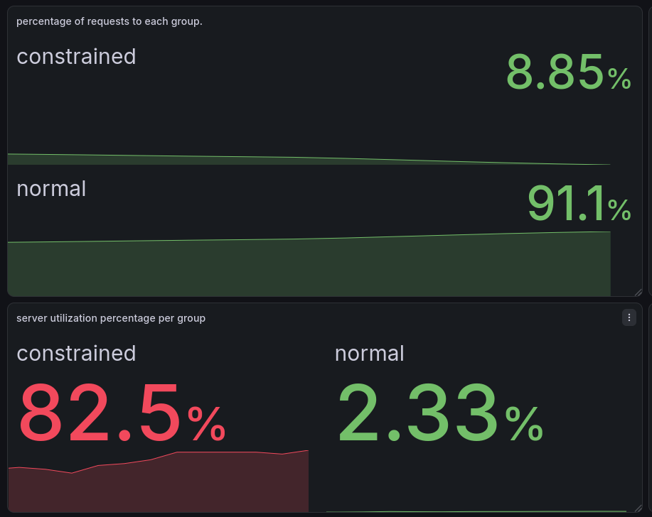
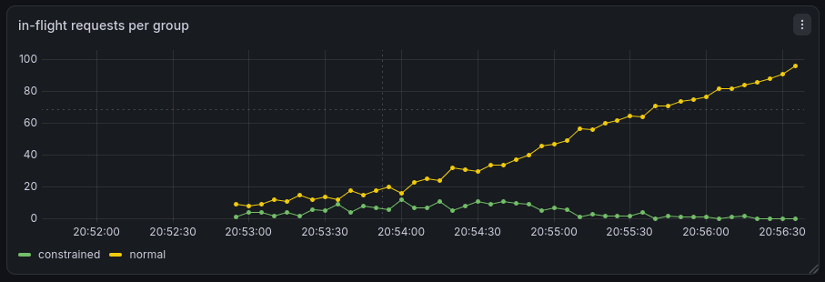

# flux
a netflix-inspired adaptive load balancer written in go.

the design/architecture of this balancer is from netflix's approach to edge load balancing, covered in [rethinking edge load balancing (netflix's blog)](https://netflixtechblog.com/netflix-edge-load-balancing-695308b5548c). if you want the background before diving in, that post is a good place to start.


## how does it work?
backends register themselves in consul with tags for their group and capacity (`flux-backend-group`, `flux-max-requests`). the balancer watches consul for healthy instances and keeps them in a cluster pool.

for every request it does power-of-two-choices: pick two random healthy servers, score them, send the request to the better one. the score is a weighted mix of:
- in-flight request count (normalized by max capacity)
- server utilization (reported by each backend via the `x-flux-server-utilization` header)
- rolling error rate (1-minute sliding window, 1-second buckets)

servers above their utilization or error thresholds get filtered out first, with a fallback to any available server so we never 503 when there is still capacity.

new servers start in probation and only get one request at a time until they prove themselves with a successful response.

everything is exported to prometheus (`balancer_requests_total`, inflight, utilization, error rate, probation) so you can actually see the balancer thinking.

## how i tested it?

i split the backends into two groups so the balancer had to account for different capacity:

- `normal`: 10 replicas, configured for up to 300 requests each.
- `constrained`: 10 replicas, configured for up to 4 requests each.

both groups register with consul and receive traffic through the same balancer. the k6 profile is a single 15-minute run defined in `k6/load_test.js`:

| phase | rate | duration |
| --- | --- | --- |
| ramp up | 100 → 1,500 req/s (in 250 req/s steps) | 6m |
| peak | 1,500 req/s | 4m |
| ramp down | 1,500 → 0 req/s | 5m |

optional chaos experiments can run during the peak period to observe how the balancer responds to injected failures or latency. the ramp lives in `k6/load_test.js` and you can change it — resize the stages to make the run shorter/longer, hold a different peak, or ramp down faster/slower.

i used these prometheus metrics to see how traffic and backend health changed between groups:

- `balancer_requests_total`: requests routed to each backend, used to calculate each group's traffic share and request rate.
- `balancer_server_inflight_requests`: requests currently in flight to each backend.
- `balancer_server_utilization`: utilization reported by the backend.
- `balancer_server_rolling_error_rate`: each backend's rolling error ratio over the last minute.
- `balancer_server_in_probation`: whether a backend is still in probation.

these metrics are labeled by `backend_group`, so the queries below show traffic and backend health for each group. during chaos runs, use the same metrics to observe the effects of injected faults.

### what it looks like





you can see the balancer doing its thing here. as the constrained group gets pushed toward its capacity (utilization climbs to ~82.5%, above the 75% threshold), the balancer filters it out and shifts almost all traffic to the normal group (~91.1% of requests). so the constrained group's in-flight requests stay low and flat.

feel free to configure it however you like.  change the scoring weights, thresholds, or the backend group capacities and watch how the balancer reroutes traffic in response.

## repo layout
- `cmd/balancer` — balancer entrypoint
- `cmd/server` — backend entrypoint
- `internal/balancer` — picking, scoring, forwarding, consul watch
- `internal/server` — backend handlers + utilization middleware
- `internal/types` — shared server/env types + rolling error rate
- `internal/utils` — env parsing + consul tag parsing
- `internal/metrics` — prometheus gauges/counters
- `k6/` — load test scripts
- `k8s/` — consul, backends, balancer, monitoring manifests
- `screenshots/` — grafana captures of the balancer under load
- `docker/` — balancer + backend images

## how to run it?

### prerequisites
- docker, minikube, and kubectl
- go (1.26+) and [k6](https://k6.io/) for building images and load testing

### 1. start minikube and build the images
```bash
minikube start --cpus=4 --memory=8192
eval "$(minikube docker-env)"
docker build -f docker/Dockerfile.flux-backend -t flux-backend:latest .
docker build -f docker/Dockerfile.flux-balancer -t flux-balancer:latest .
```

### 2. deploy consul, backends, and the balancer
```bash
kubectl apply -f k8s/cluster/
kubectl get pods -n flux
```

### 3. access the balancer
```bash
minikube service -n flux flux-balancer --url
curl "$(minikube service -n flux flux-balancer --url)/api"
```
use the url printed by minikube as `BASE_URL` for load testing. avoid `kubectl port-forward` for load tests.

### 4. run the load test
```bash
BASE_URL=http://<minikube-balancer-url>:8090 k6 run k6/load_test.js
```

### 5. enable monitoring (optional)
with kube-prometheus-stack installed, apply the servicemonitor and grafana dashboard:
```bash
kubectl apply -f k8s/cluster/40-flux-balancer-monitor.yaml
kubectl apply -f k8s/cluster/50-flux-dashboard.yaml
```

### 6. run chaos experiments (optional)
with chaos mesh installed:
```bash
kubectl apply -f k8s/chaos/chaos_abort.yaml
kubectl apply -f k8s/chaos/chaos_latency.yaml
```

## env vars

**server:**
- `CONSUL_HTTP_ADDR` (default `http://localhost:8500`)
- `SERVICE_ID` (default `flux-server-1`)
- `SERVICE_NAME` (default `flux-backend`)
- `SERVICE_HOST` (default `flux-server-1`)
- `SERVICE_PORT` (default `8080`)
- `MAX_CONFIGURED_REQUEST_COUNT` (default `100`)
- `BACKEND_GROUP` (default `unknown`)

**balancer:**
- `CONSUL_HTTP_ADDR` (default `http://localhost:8500`)
- `SERVICE_HOST` (default `localhost`)
- `SERVICE_PORT` (default `8090`)
- `TARGET_SERVICE_NAME` (default `flux-backend`)

## testing + load tests
```bash
go vet ./...
go test -race -count=1 ./...
k6 run k6/load_test.js
```


## promql queries

paste these into prometheus or grafana. the `backend_group` label lets you view metrics for the `normal` and `constrained` backend groups.

request share by backend group (percent):
```promql
sum by (backend_group) (increase(balancer_requests_total[$__range]))
  / scalar(sum(increase(balancer_requests_total[$__range]))) * 100
```

requests per second by group:
```promql
sum by (backend_group) (rate(balancer_requests_total[1m]))
```

average and maximum backend utilization by group:
```promql
avg by (backend_group) (balancer_server_utilization)
max by (backend_group) (balancer_server_utilization)
```

in-flight requests by group:
```promql
sum by (backend_group) (balancer_server_inflight_requests)
```

average and maximum rolling error rate by group (multiply by 100 for percent):
```promql
avg by (backend_group) (balancer_server_rolling_error_rate) * 100
max by (backend_group) (balancer_server_rolling_error_rate) * 100
```

servers in probation by group:
```promql
sum by (backend_group) (balancer_server_in_probation)
```

## final notes
this was a really fun project to build. i wouldn't say this is production-ready, but it was a great exercise to understand how load balancers work and visualize their routing decisions/behaviour under load. 

what i've realized is how much i need to improve building stuff like all the way from breaking down a problem, designing a solution, implementing it, and testing it. i think i'll get better at it with practice.

```
built by mohammed numaan
```
